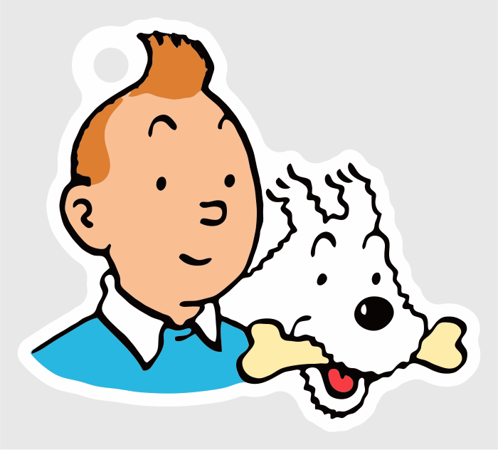
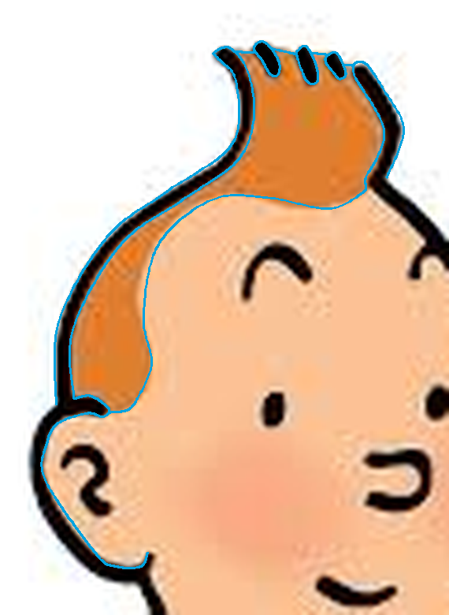
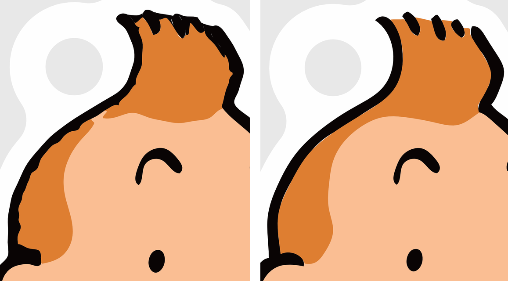

# Keychain-Generator

Turns a picture (PNG or JPEG) into a double-sided, multi-colour keychain for 3D printing.

The picture's colours are matched to your filaments, cleaned up so every line and area is at
least 0.4 mm wide, and traced into smooth outlines. Around it comes a black rim with a tab
and a keyring hole. The keychain is 3 mm thick:

| Layer | Height | What it is |
|---|---|---|
| back face | 0 – 0.8 mm | the picture, mirrored when seen from behind |
| core | 0.8 – 2.2 mm | the rim colour across the whole keychain, so these layers need no filament change |
| front face | 2.2 – 3.0 mm | the picture |

Pictures with flat colours and dark outlines work best, such as cartoons or logos.

## Setup

Requires Python 3.13 or newer, on Windows, macOS or Linux.

```sh
python3 -m venv .venv
source .venv/bin/activate
pip install -e ".[dev]"
```

On Windows (PowerShell), activate with `.venv\Scripts\Activate.ps1` instead.

## Usage

### In the browser

```sh
keychain web
```

This opens a page on your own computer (http://127.0.0.1:8765, not reachable from elsewhere):

1. Choose a picture. Its main colours appear as a list; change, remove or add filaments, or
   use **Pick from picture** to add the colour you click on, such as a small red tongue.
2. **What to keep**: paint roughly where the automatic background is wrong. **Background**
   (red) leaves that part out, **Keep** (green) keeps it even if it looks like background.
3. **Details**: paint **Smooth** (blue) where the curves should be calmer than the picture,
   such as a wobbly JPEG edge, and **Detailed** (yellow) where they should follow it more
   closely. The **Paint** button next to a colour paints with that colour on the picture, for a
   detail the colours miss. **Connect**: click A, then B, to join an area that fades out in
   between, such as a strip of hair along a hairline; it gets a strip of the colour at A.
   **Spline**: click points along a curve; it runs on to the pointer, to show how it will
   bend. Click the last point again (orange ring) to finish it as an edge: the border between
   the colours on either side follows that smooth curve, such as the outer edge of a head of
   hair. Or click the first point (green ring) to close it into a shape, filled with the colour
   last chosen with Paint, such as a pill-shaped strand of hair in black. A click near a curve
   already drawn lands exactly on it (pink dot), so splines can start and end on each other;
   hold Alt to place a point freely. An area that splines close off all round gets one colour,
   its most common one, while details inside it that touch none of the curves, such as an eye,
   stay. Escape cancels a curve.

   Each of the two has its own **Erase**: the one under Details also takes off colour paint,
   Connect lines and splines. Shift and scroll zooms in on the picture to draw in detail; the
   scale above it goes back to 100%, next to the brush size.
4. Set the size, and the **curve tolerance**: how far the curves may stray from the picture.
   Every edge is drawn as splines with as few points as fit within it, with sharp corners
   kept sharp and small round blobs such as eyes drawn as ellipses.
5. **Place ring in preview**, then click where the keyring hole should go; a stem joins it to
   the keychain if needed.
6. **Download** a zip with the 3MF and the STLs.

**Save project** keeps everything in one `.keychain.json` file: the picture, the painted masks
and colour paint, the Connect lines and splines, the colours, sizes, rim colour and ring
position.
**Open project** carries on where you left off.

The preview updates by itself after every change; each one takes a few seconds.

### On the command line

First see which colours the picture has:

```sh
keychain colours picture.png
```

It prints the main colours and a ready-made command. Add details the detection missed, such as
a small red tongue, and leave out what you do not want to print, such as soft pink blushes:
pixels of a left-out colour go to the nearest colour that is left.

```sh
keychain make picture.png --colours black=#090404 white=#fefefe skin=#fabe93 red=#e03838
```

Without `--colours`, `make` uses the detected colours. The darkest colour is the ink: the
lines, and unless `--rim-colour` says otherwise also the rim, the ring and the core.

| Option | Default | Meaning |
|---|---|---|
| `--width` | `50` | picture width in mm, without the rim that comes round it; also a guide so its lines are printable |
| `--height` | | picture height in mm; alone it sets the height only, with `--width` the picture fits within both |
| `--thickness` | `3.0` | total thickness in mm |
| `--core` | `1.4` | middle layer in mm, in the rim colour; the faces share the rest |
| `--rim` | `1.5` | border around the picture in mm |
| `--hole` | `4.0` | keyring hole diameter in mm |
| `--rim-colour` | ink | name of the colour for the rim, the ring and the core, such as `white`: a light rim keeps the picture's outer lines visible |
| `--project` | | a `.keychain.json` saved by the web page, instead of the picture and `--colours`; the size options and `--rim-colour` given here win over the project's |
| `--out` | `out` | output folder |
| `--open` | | show the output folder when done |

`make` writes a folder named after the picture:

| File | What it is |
|---|---|
| `picture.3mf` | the whole keychain in one file, every colour of every layer a named part |
| `picture-preview.svg` | the front face, to check the colours |
| `picture-front-*.stl`, `picture-core.stl`, `picture-back-*.stl` | the same parts as separate STLs |

Import the 3MF in the slicer and give each part its filament.

## Example: Tintin and Snowy

A small JPEG of Tintin and Snowy, made into a keychain with a white rim, by drawing a few
splines round the hair and nothing else. The project is in
[`docs/example/kuifje.keychain.json`](docs/example/kuifje.keychain.json): open it with
**Open project** to follow along, or make it straight away:

```sh
keychain make --project docs/example/kuifje.keychain.json
```


**Colours.** Seven filaments: black for the lines, white, skin, orange for the hair, light blue
for the jumper, cream for the bone and red for the tongue. **Rim colour** white, so the black
outline stays visible against it.

**Without drawing anything,** most of the keychain is already fine, but the hair is not: the
picture is only 225 pixels wide and blurred, so the outline round the hair is ragged, the
strands of the quiff run into each other and the outline, and a thin strip of hair along the
hairline breaks up.



**Splines** fix the hair, drawn with the picture zoomed in (shift and scroll):

- An edge along the hairline, between the hair and the skin, from behind the ear to the right
  side of the quiff.
- An edge up the inside of the outline round the hair and back down its outside, on the left
  and on the right of the quiff, so the outline gets an even width.
- Three shapes in black for the strands of the quiff, with short edges between their tips and
  the outline for the top of the hair.
- An edge round the ear, with a short one joining it to the hairline edge.

The splines round the hair start and end on each other, so together they close it off all
round: it becomes one even orange, with no patches of the picture's blur left in it.



**Ring:** **Place ring in preview**, then a click at the top left, beside the quiff. The result:


The hair close up, without the splines and with them:



**That is all it took.** Ten edges and three shapes on one part of the picture, and the
program did the rest: no tracing the whole picture by hand, no converting it to DXF or SVG,
and no building it up layer by layer in CAD software. **Download** gives the 3MF, ready for the
slicer; there, give each part its filament.

## Pictures of characters

Characters such as Tintin are protected by copyright and trademarks. Printing one for yourself
is one thing; sharing the files or the keychains, for example on MakerWorld, needs permission.
